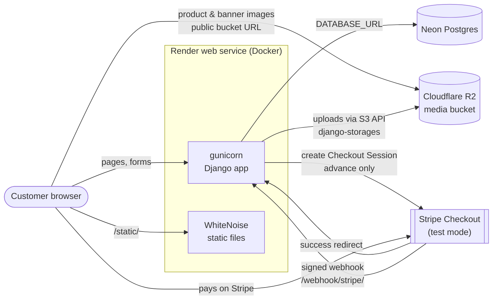
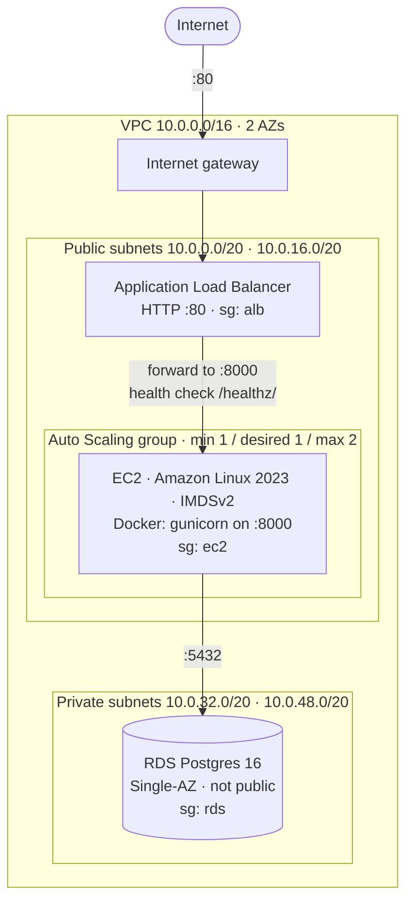
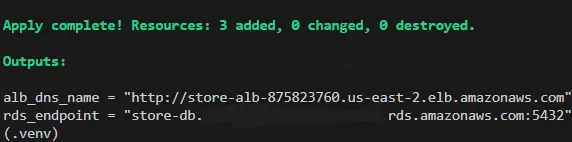
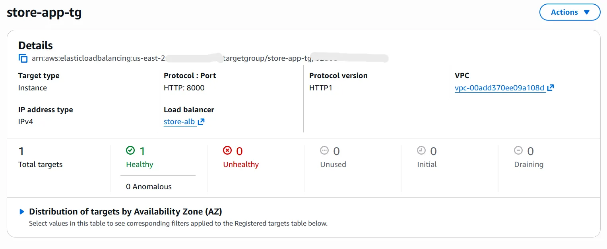
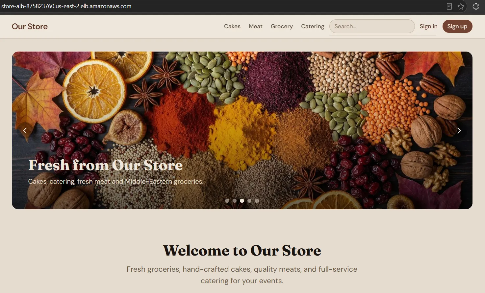
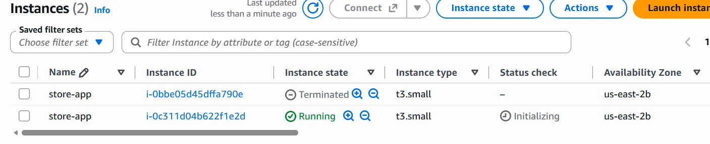

# Architecture

How Levant Table runs today, the AWS reference architecture it was provisioned on with Terraform, and what would come next.

- [1. Business case](#1-business-case)
- [2. Live architecture](#2-live-architecture-render--neon--r2--stripe)
- [3. AWS architecture](#3-aws-architecture-terraform)
- [4. Terraform layout](#4-terraform-layout)
- [5. Apply walkthrough](#5-apply-walkthrough)
- [6. Verification evidence](#6-verification-evidence)
- [7. Trade-offs and next steps](#7-trade-offs-and-next-steps)

---

## 1. Business case

Levant Table is a (fictional) family-run store with four revenue streams under one roof: groceries, a custom-cake counter, meat sold by weight, and event catering. Its catering and custom-cake business ran on phone calls and walk-ins, so orders were missed during busy hours, large orders no-showed because nothing committed the customer, and staff lost hours to phone tag over cake details. The app lets customers browse and order online, pre-pay a deposit (the "advance") to commit the order and choose a pickup window, while staff run the whole order lifecycle from the Django admin.

---

## 2. Live architecture (Render + Neon + R2 + Stripe)

**Live:** https://levant-table.onrender.com



- **Web service:** Render builds the repo's `Dockerfile` (`python:3.12-slim`, non-root user). On start, `entrypoint.sh` runs `migrate`. The image's default command then runs `collectstatic` and starts `gunicorn config.wsgi:application`.
- **Static files:** served by WhiteNoise from the same process (`CompressedManifestStaticFilesStorage`: compressed files with hashed names). There's no CDN or separate static host.
- **Database:** Neon Postgres, reached via the `DATABASE_URL` env var (`django-environ`).
- **Media:** Cloudflare R2. When the `R2_*` env vars are set, `config/settings.py` switches the default storage to `storages.backends.s3.S3Storage` (django-storages + boto3).
  - Uploads go to the bucket through R2's S3 API.
  - `.url` returns unsigned public-bucket URLs, so browsers load images straight from R2.
  - Without those variables (local development) media stays on the local filesystem.
- **Payments:** Stripe Checkout in test mode, charging only the advance.
  - Orders are confirmed by three paths, all calling the same idempotent `confirm_paid_session()`, which locks the Payment and Order rows with `select_for_update`:
    1. **Success redirect.** The app re-fetches the session from Stripe rather than trusting the browser.
    2. **Signed webhook** at `/webhook/stripe/`, configured on the live site.
    3. **`reconcile_stripe_orders` management command**, run on demand or by an external scheduler. No scheduler is configured in this repo.
  - Whichever path arrives first confirms the order; the others do nothing.

---

## 3. AWS architecture (Terraform)

The same container was deployed to AWS as a reference architecture with the Terraform in [`terraform/`](./terraform), verified end to end, and then destroyed to save cost. Region `us-east-2`, local state.



**Network** (`vpc.tf`)
- A VPC (`10.0.0.0/16`, DNS support and hostnames on) spanning the first two available AZs.
- Two public subnets (`10.0.0.0/20`, `10.0.16.0/20`) and two private subnets (`10.0.32.0/20`, `10.0.48.0/20`), one of each per AZ.
- An internet gateway, plus a public route table that sends `0.0.0.0/0` to it, associated with both public subnets.
- The private subnets keep the VPC's local-only main route table.

**No NAT gateway (a cost choice).** App instances therefore run in the public subnets with public IPs so they can install packages, clone the repo and reach Stripe and R2. They're still not open to the internet, because their security group accepts the app port only from the ALB. The private subnets have no outbound route at all, which RDS doesn't need.

**Security-group chain** (`security_groups.tf`): each tier accepts traffic only from the tier in front of it.

| Group | Inbound | Outbound |
|---|---|---|
| `alb` | TCP 80 from `0.0.0.0/0` | all |
| `ec2` | app port (8000) **from the `alb` group only**; TCP 22 from `my_ip_cidr` only if that variable is set | all |
| `rds` | TCP 5432 **from the `ec2` group only** | all |

**Load balancer** (`alb.tf`)
- An internet-facing Application Load Balancer in both public subnets.
- An HTTP listener on `:80` forwards to a target group on port 8000 (`var.app_port`).
- Health check: `GET /healthz/` must return `200`, checked every 30 s (2 passes to become healthy, 3 failures to become unhealthy). Deregistration delay is 30 s.
- `/healthz/` is answered by `apps.core.middleware.HealthCheckMiddleware`, the first middleware in the stack. It returns `ok` before Django validates the Host header (the ALB probes each instance by its private IP, which isn't in `ALLOWED_HOSTS`) and without touching the database.
- The path needs its trailing slash: `/healthz` would fall through to Django and get a 400.

**Compute** (`compute.tf`)
- **AMI:** the latest Amazon Linux 2023 x86_64 image, looked up with a data source.
- **Launch template:**
  - `t3.small` by default, with a public IP and the `ec2` security group
  - an optional SSH key pair
  - IMDSv2 required (`http_tokens = "required"`)
  - the user-data boot script
- **Auto Scaling group:**
  - min 1, desired 1, max 2, across both public subnets, registered in the target group
  - `health_check_type = "ELB"`, so an instance failing the ALB health check gets replaced
  - a 600 s grace period, because the first boot builds the image before the app answers
  - an `instance_refresh` block, so changes to the launch template roll out to running instances
  - no scaling policies: max 2 leaves room for replacements and instance refreshes, not autoscaling on load

**Boot script** (`user_data.sh.tftpl`, rendered with `templatefile`)
1. Installs Docker, git and the Docker Compose plugin, then enables Docker.
2. Clones `var.repo_url` (the public GitHub repo) to `/opt/app`.
3. Writes a production `.env` (mode 600) containing:
   - `DEBUG=False` and the secret key
   - `ALLOWED_HOSTS` (the ALB DNS name, localhost) and `CSRF_TRUSTED_ORIGINS=http://<alb-dns>`
   - `DATABASE_URL`, pointing at the RDS address with the password URL-encoded
   - `ACCOUNT_EMAIL_VERIFICATION=none` (the lab has no SMTP)
   - the Stripe test keys and the R2 variables
4. **Builds the Docker image on the instance**, then runs `python manage.py seed` in a one-off container. The entrypoint migrates first, and seed is idempotent.
5. Starts the app container (`--restart unless-stopped`), publishing the app port to gunicorn's `:8000`.

**Database** (`rds.tf`)
- A DB subnet group across the two private subnets.
- RDS for PostgreSQL 16: `db.t3.micro` by default, 20 GB gp3, `multi_az = false`, `publicly_accessible = false`, attached to the `rds` security group.
- Lab-friendly teardown: `skip_final_snapshot = true` and `deletion_protection = false`.

**Outputs** (`outputs.tf`): `alb_dns_name` (as an `http://` URL) and `rds_endpoint`.

---

## 4. Terraform layout

| File | Holds |
|---|---|
| `providers.tf` | Terraform `>= 1.5.0`, AWS provider `~> 5.70`, region from `var.region`, default `Project` tag; local state |
| `variables.tf` | All inputs; secrets marked `sensitive`; `db_password` validated against RDS's character rules |
| `vpc.tf` | AZ data source, VPC, 2 public + 2 private subnets, internet gateway, public route table and associations |
| `security_groups.tf` | The `alb` → `ec2` → `rds` security-group chain |
| `alb.tf` | Load balancer, target group with the `/healthz/` health check, HTTP :80 listener |
| `compute.tf` | Amazon Linux 2023 AMI lookup, launch template, Auto Scaling group |
| `user_data.sh.tftpl` | Instance boot script (install, clone, `.env`, build, seed, run) |
| `rds.tf` | DB subnet group and the Postgres 16 instance |
| `outputs.tf` | `alb_dns_name`, `rds_endpoint` |
| `terraform.tfvars.example` | Every variable with a placeholder and a one-line comment |
| `.terraform.lock.hcl` | Provider version lock (committed) |

`terraform plan` on an empty account creates **19 resources**: the VPC, 4 subnets, the internet gateway, the route table, 2 route-table associations, 3 security groups, the ALB, the target group, the listener, the launch template, the ASG, the DB subnet group and the RDS instance.

---

## 5. Apply walkthrough

**Prerequisites**
- Terraform ≥ 1.5 and AWS credentials for an account that can create the resources above (e.g. an AWS CLI profile).
- The code you want to run must be **pushed** to the repo in `repo_url`, because instances clone GitHub, not your machine.
- Optional: an EC2 key pair in `us-east-2` and your IP (`curl https://checkip.amazonaws.com`) for SSH.

**Configure**
```bash
cd terraform
cp terraform.tfvars.example terraform.tfvars
```
Fill in `db_password` (8+ characters, no `/ @ "` or spaces), `django_secret_key`, and the Stripe test keys. Set the five `r2_*` values so media works: with `DEBUG=False` the app serves no local media. `terraform.tfvars` is git-ignored.

**Apply**
```bash
terraform init
terraform plan      # expect: 19 to add
terraform apply
```
RDS takes the longest. The outputs are `alb_dns_name` (open it in a browser) and `rds_endpoint` (reachable only from the app instances).

**Verify**
1. **Apply succeeded** and printed `alb_dns_name`.
2. **Target healthy:** EC2 → Target groups → `store-app-tg` → Targets shows the instance `healthy`. The first boot builds the image, so allow a few minutes.
3. **Storefront over the ALB:** open the `alb_dns_name` URL.
4. **Self-heal:** terminate the running instance, either in the console (EC2 → Instances → `store-app` → Instance state → Terminate) or with:
   ```bash
   aws ec2 terminate-instances --instance-ids <instance-id> --region us-east-2
   ```
   The Auto Scaling group notices that capacity dropped below the minimum and launches a replacement. Check EC2 → Auto Scaling groups → `store-app-asg` → **Activity**, or:
   ```bash
   aws autoscaling describe-scaling-activities --auto-scaling-group-name store-app-asg --region us-east-2
   ```
   The replacement boots, builds, seeds (a no-op, since the database already has the data) and turns healthy in the target group.

Boot logs are in `/var/log/cloud-init-output.log` on the instance. To create an admin user over SSH, run `sudo docker exec -it store python manage.py createsuperuser`.

**Destroy**
```bash
terraform destroy
```
**Cost:** the ALB, the EC2 instance, RDS and public IPv4 addresses bill by the hour, so the lab only costs money while it's running. Destroy it as soon as you're done.

**Afterwards, delete the local secrets.** `terraform.tfstate`, `terraform.tfstate.backup` and `terraform.tfvars` contain the database password, Django secret key, Stripe and R2 keys in plaintext. All three are git-ignored, but they shouldn't stay on disk:
```bash
rm terraform.tfstate terraform.tfstate.backup terraform.tfvars
```

---

## 6. Verification evidence

The lab was applied, verified and destroyed on **2026-11-06** in `us-east-2`. Account IDs are redacted.

**1. `terraform apply` completed and printed the outputs**



**2. The target group reports the instance healthy on `/healthz/`**



**3. The storefront served through the ALB DNS name**



**4. Self-heal: the manually terminated instance has been replaced by a new one launched by the Auto Scaling group**



After those checks, `terraform destroy` removed every resource.

---

## 7. Trade-offs and next steps

This was a short-lived lab, and these were deliberate shortcuts:

- **Secrets travel through user data.** The database password, Django secret key, Stripe and R2 keys are rendered into the boot script, so anyone who can read the instance's user data or the Terraform state can see them. **Next:** store them in SSM Parameter Store or Secrets Manager and have the instance fetch them at boot with an IAM instance role.
- **The image is built on every instance.** Each boot clones the repo and runs `docker build`, which slows replacement and means instances could run different code if the repo changes between launches. **Next:** build once in CI, push to ECR and have instances pull a pinned tag.
- **HTTP only.** There's no domain or TLS certificate, so the ALB listens on port 80 only. **Next:** a Route 53 domain with an ACM certificate, an HTTPS listener with an HTTP→HTTPS redirect, and the app's env-gated settings (`HTTPS_PROXY`, `SECURE_SSL_REDIRECT`, secure cookies) turned on.
- **Single-AZ RDS.** The account was limited to Single-AZ. **Next:** `multi_az = true` for automatic failover. The `/healthz/` endpoint already avoids the database, so app instances wouldn't be marked unhealthy during a failover.
- **No CloudWatch alarms yet.** **Next:** alarms on ALB 5xx and unhealthy-host count, RDS CPU and storage, with notifications.
- **Local Terraform state.** **Next:** an S3 backend with state locking, so state is shared and isn't a plaintext file on one laptop.
- **App tier in public subnets, no NAT.** This was the cost choice described above. **Next:** private app subnets behind a NAT gateway (or VPC endpoints), leaving only the ALB public.
