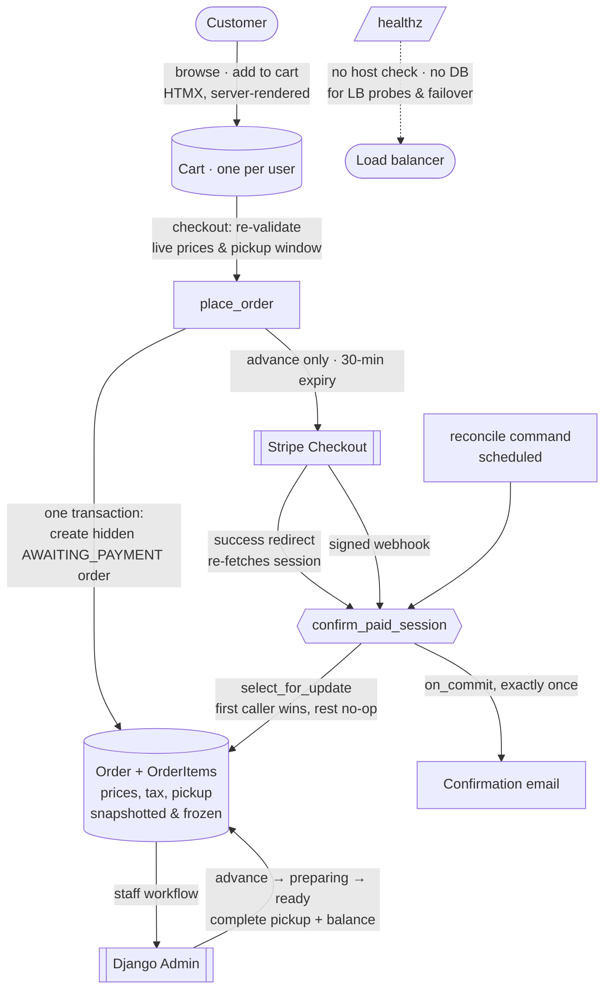

# Levant Table

A production-patterned e-commerce platform for a Middle-Eastern grocery, bakery, butcher, and caterer — built to demonstrate full-stack engineering, system design, and cloud/operations practice end to end.


> **Live demo:** _<your-app>.onrender.com_ · **Admin:** `/admin` (credentials on request) · Payments run in **Stripe test mode** — use card `4242 4242 4242 4242`, any future expiry, any CVC. No real charges.

---

## The problem it solves

**Levant Table** is a (fictional) family-run store with four revenue streams under one roof — groceries, a custom-cake counter, meat by weight, and event catering. Its catering and custom-cake business runs on **phone calls and walk-ins**: orders get missed during busy hours, large orders no-show because nothing commits the customer, and staff lose hours to phone tag over cake details. This app is the answer — customers browse and order online, **pre-pay a deposit** to commit the order, choose a pickup window, and staff run the whole lifecycle from the admin back office.

## What this project demonstrates

- **System design** — a multi-table product hierarchy, snapshot-based order integrity, and a single canonical money function; deliberate modeling of four product types with genuinely different pricing rules.
- **Reliability engineering** — an idempotent, three-path payment-confirmation flow that self-heals a dropped webhook; a load-balancer health endpoint designed to stay green during a database failover.
- **Cloud & operations** — containerized, twelve-factor configuration, deployed on Render + Neon, with a full AWS reference architecture **designed and provisioned in Terraform** (see [`ARCHITECTURE.md`](./ARCHITECTURE.md)).
- **Software engineering** — 28 tests with the payment gateway mocked, per-line tax math to the cent, and clean separation between HTTP views and service logic.

---

## Architecture at a glance

The app is **deployed** on Render (web) + Neon (serverless Postgres). A full AWS architecture — ALB + Auto Scaling Group + RDS, provisioned with Terraform — is **designed and documented** separately as the "how this scales with the business" story; it is intentionally not the demo's runtime (see [`ARCHITECTURE.md`](./ARCHITECTURE.md)).



**Why three confirmation paths?** Payment confirmation never trusts the browser. The success redirect re-fetches the session from Stripe, a signed webhook acts as a backup, and a scheduled reconcile command sweeps up anything both missed. All three funnel through one `confirm_paid_session()` guarded by `select_for_update` — so an order is confirmed once, the advance is captured once, and the email is sent once, no matter which path arrives first or in what order. This is what lets the app survive a webhook that never fires (which is exactly what happens without a tunnel in local dev, and on any host where the webhook isn't wired).

---

## Key engineering decisions

- **Multi-table inheritance for products.** A concrete `Product` base with `CakeProduct` / `MeatProduct` / `GroceryProduct` / `CateringProduct` subtypes — because the four kinds price differently (cakes by size, meat by the pound, grocery by unit, catering by tray *or* by weight) and diverge in their fields. One query path, four real shapes.
- **Snapshotting for order integrity.** Cart and order line items capture name, unit price, size, flavor, and custom-cake choices **at add time** and never refresh from live data. Orders freeze totals, tax, the advance/balance split, and the pickup window at placement. Editing a product later never rewrites history; `OrderItem.product` is `PROTECT` + nullable so a sold product can't be deleted out from under an order.
- **One canonical money function.** `compute_line_total(unit_price, qty)` — `Decimal`, `ROUND_HALF_UP` to cents — is the single source of truth, called by cart, checkout, and order creation. Tax is computed per line against each category's own `tax_rate`.
- **Pickup windows as derived, snapshotted data.** Windows come from a date's `StoreClosure` override or the weekday's `StoreHours`, with a "next open day" rule and a 10 AM readiness floor; the computed window is frozen onto the order at placement because store hours are editable.
- **Email-only auth, no anonymous carts.** Custom user model (email as the login field) via allauth; cart and checkout require login, so there's one durable cart per user and no session-merge complexity.

## Operations & reliability

- **Health endpoint built for load balancers.** `/healthz/` is served by middleware that runs **first** in the stack — it returns `ok` without host validation or any DB access, so it answers from a private IP behind an ALB and keeps returning 200 during a database failover. Application-grade liveness, not a static file.
- **Twelve-factor config.** All configuration is env-driven via `django-environ`; `SECRET_KEY` and `DATABASE_URL` are required with no insecure fallback. Production security (proxy SSL header, SSL redirect, secure cookies) is **opt-in by env var**, so the *same image* runs HTTP in a lab and HTTPS in production without a code change.
- **Container design.** `python:3.12-slim`, dependencies in a cached layer, runs as a **non-root** user restricted to `staticfiles/` and `media/`. The entrypoint runs migrations on start; `collectstatic` runs at startup (not build) so building needs no secrets. Served by gunicorn; static files by WhiteNoise with compressed, hashed filenames.
- **Self-healing order recovery.** The `reconcile_stripe_orders` command reconciles every unconfirmed order against Stripe — confirming paid-but-unconfirmed orders, removing stale abandoned ones, and (with `--audit`) listing paid sessions never applied to an order as refund candidates. Designed to run on a schedule.

---

## Tech stack

| Layer | Choice |
|---|---|
| Language / framework | Python 3.12, Django 5.2 |
| Database | PostgreSQL 16 (Neon serverless in production) |
| Payments | Stripe Checkout (test mode), webhook signature verification |
| Frontend | Server-rendered Django templates + HTMX; Tailwind CSS 3.4 (compiled, committed); small vanilla JS |
| Auth | django-allauth (email-only) |
| Server / static | gunicorn + WhiteNoise (`CompressedManifestStaticFilesStorage`) |
| Config | django-environ (`.env` + real env vars) |
| Packaging | Docker + docker-compose |
| Deploy | Render (web) + Neon (Postgres); AWS reference architecture in Terraform (designed) |

---

## Run it locally

### With Docker (recommended)

```bash
git clone <repo-url>
cd store-website
cp .env.example .env          # set SECRET_KEY and DB_PASSWORD; leave DATABASE_URL as-is (Compose overrides it)
docker compose up --build     # builds, waits for Postgres, migrates, starts the dev server
```

App at **http://127.0.0.1:8000**. Then, in a second terminal, seed data and create an admin:

```bash
docker compose exec web python manage.py seed           # categories, menu, store hours, demo products
docker compose exec web python manage.py createsuperuser
```

Set `ACCOUNT_EMAIL_VERIFICATION=none` in `.env` for fast local testing (no SMTP needed); with `EMAIL_HOST` blank, emails print to the console.

### Testing a payment

Payments confirm on the Stripe **success redirect**, so checkout works without a webhook. Use test card `4242 4242 4242 4242` (any future expiry, any CVC). To also exercise the backup webhook path, forward events with the Stripe CLI:

```bash
stripe listen --forward-to localhost:8000/webhook/stripe/   # copy the whsec_... into .env, then: docker compose restart web
```

More test cards: 3D Secure `4000 0025 0000 3155`, declined `4000 0000 0000 9995` ([full list](https://docs.stripe.com/testing)).

---

## Deployment

**Live demo:** Render (web service, Docker) + Neon (serverless Postgres). Configuration is entirely env-var driven; the container reads `DATABASE_URL` (Neon's pooled connection string), `SECRET_KEY`, `ALLOWED_HOSTS`, and the Stripe test keys. Migrations run automatically on deploy via the entrypoint.

**Reference architecture (designed, in Terraform):** an AWS deployment — ALB + Auto Scaling Group of containers + RDS Postgres, with CloudWatch monitoring and security-group segmentation — sized for the business's growth. The health endpoint, stateless app tier, env-gated security, and 30-minute checkout expiry were all built with that target in mind. Full rationale, diagram, and the Terraform in [`ARCHITECTURE.md`](./ARCHITECTURE.md).

---

## Testing

28 tests (Django `TestCase`, Stripe mocked):

```bash
docker compose exec web python manage.py test
```

| Suite | Covers |
|---|---|
| `orders` (20) | Redirect-only confirmation; redirect + webhook in either order confirm exactly once; unpaid/foreign sessions ignored; cart survives checkout; customer-facing status mapping; abandoned-checkout handling (discard vs. paid-after-all); reconcile (paid / dry-run / stale / recent); complete-with-balance idempotency |
| `cart` (6) | HTMX quantity/weight updates computed and rounded **server-side**, clamping, invalid input, ownership checks |
| `core` (2) | `/healthz/` bypasses host and DB checks; other paths still enforce `ALLOWED_HOSTS` |

---

## Known limitations & roadmap

Deliberate scope choices for a demo, documented honestly:

- **Media on local disk, not object storage.** User-uploaded images aren't served in production (WhiteNoise serves static, not media). The designed fix — S3 via `django-storages` — is documented but not wired, since the demo relies on seeded/fallback imagery.
- **Refunds are manual.** Order cancellation emails the customer; the advance is refunded by staff in the Stripe dashboard. `PaymentStatus.REFUNDED` exists for when this is automated.
- **Test-mode payments only.** The app is a public portfolio demo and never processes real cards.
- **Coming next:** CI/CD via GitHub Actions (tests → deploy on green), the Terraform apply walkthrough, and S3-backed media.

---

## Project structure

```
config/          Django project package (settings, urls, wsgi) — single settings module
apps/
  accounts/      Custom email-login User + manager
  catalog/       Categories, product hierarchy, cake options, catering menu, storefront + search
  cart/          Per-user cart, HTMX add/update/remove, canonical line-total function
  orders/        Checkout, Order/OrderItem/Payment, Stripe service + webhook, emails, admin actions, reconcile
  core/          SiteConfiguration, store hours/closures, banner slides, pickup-window logic, /healthz, seed
templates/       Project-level templates
static/          Tailwind source + compiled output.css (committed)
Dockerfile · docker-compose.yml · entrypoint.sh
ARCHITECTURE.md  Business case, cloud design, Terraform
```
